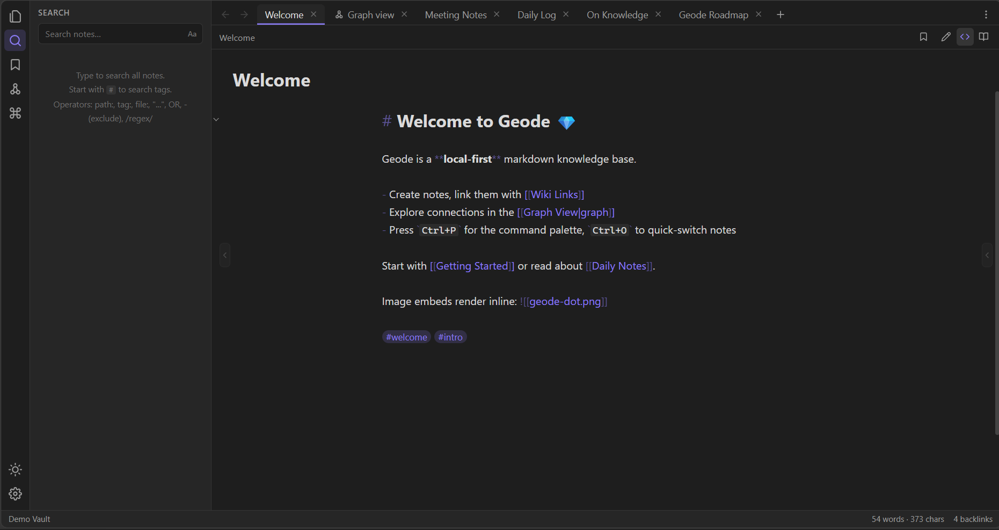
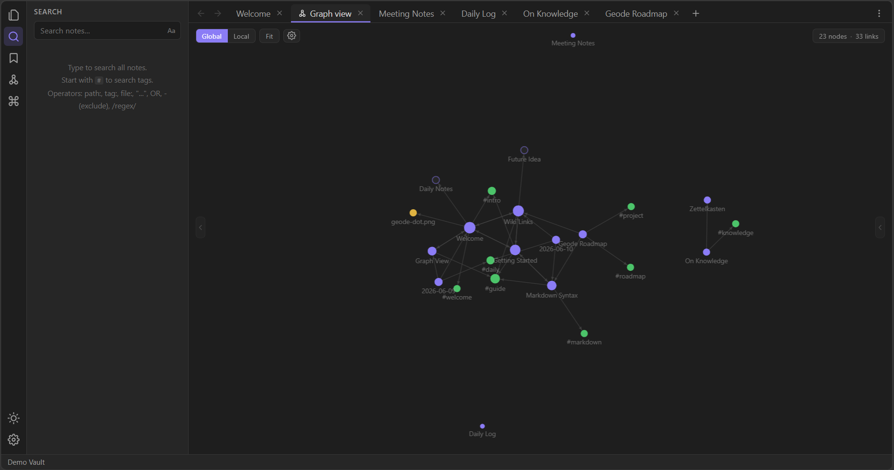
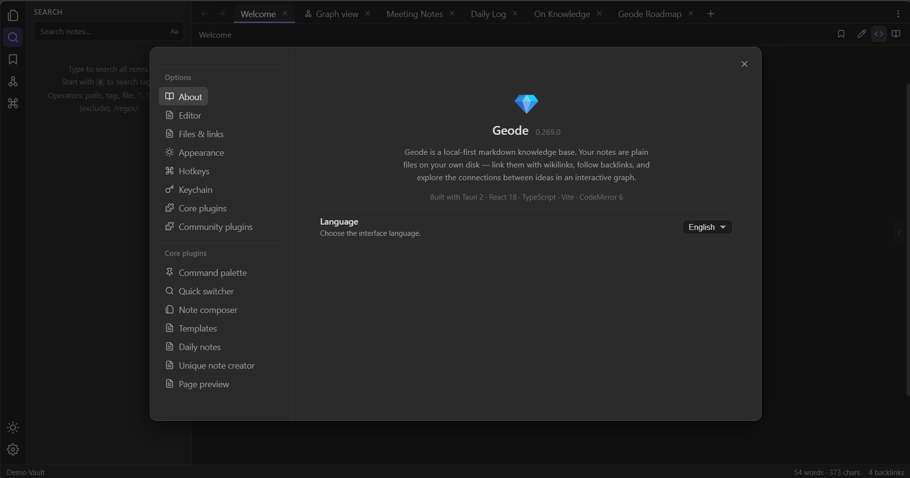
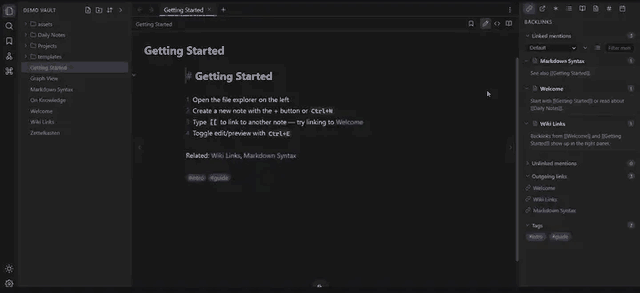
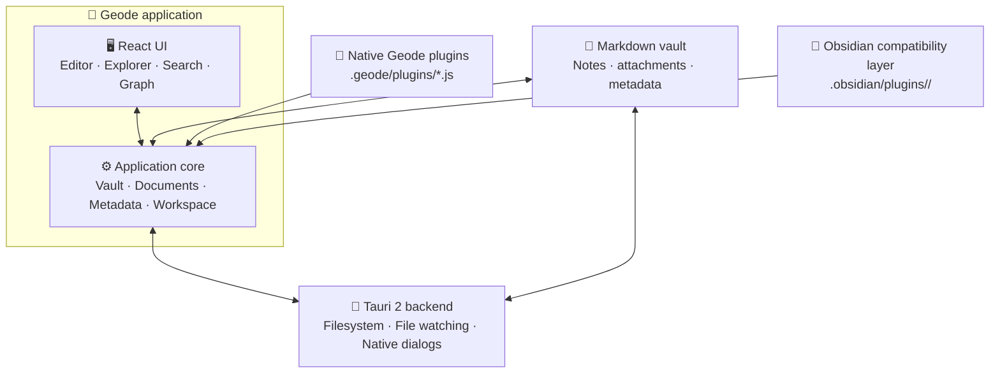
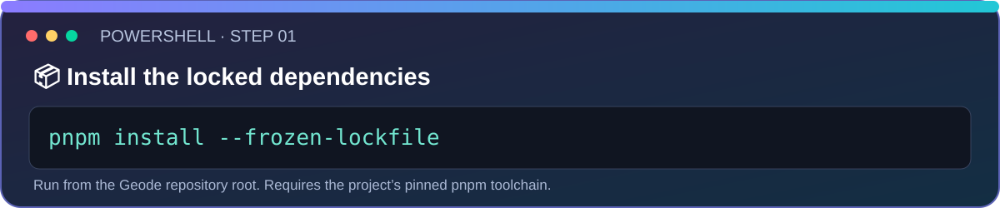
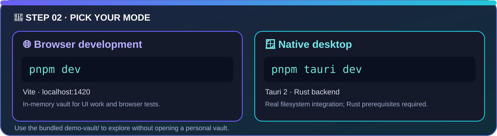

<div align="center">


<p><strong>A local-first Markdown knowledge base for Windows.</strong><br />Keep notes as ordinary files, connect ideas with wikilinks, and explore the relationships in your vault.</p>

<p>
  
  
  
  
  
</p>

<p>
  <a href="#quick-start"><strong>🚀 Install & Run</strong></a> ·
  <a href="#features"><strong>✨ Features</strong></a> ·
  <a href="#plugin-ecosystem"><strong>🧩 Plugins</strong></a> ·
  <a href="#documentation"><strong>📚 Docs</strong></a>
</p>

</div>

> [!IMPORTANT]
> **🚧 Active alpha:** Core note-taking and knowledge-navigation workflows are usable, but APIs, packaging, and Obsidian plugin compatibility are still evolving. Compatibility is incremental, not universal. Check the [compatibility guide](docs/OBSIDIAN-COMPAT.md) before depending on a specific plugin.

<a id="contents"></a>

## 📑 Contents

- [✨ At a Glance & Screenshots](#at-a-glance-screenshots)
- [🎬 Watch Geode in Action](#watch-geode-in-action)
- [🏛️ How Geode Works](#how-geode-works)
- [🚀 Features & Technology Stack](#features)
- [⚡ Quick Start & Keyboard Shortcuts](#quick-start)
- [🧩 Plugin Ecosystem](#plugin-ecosystem)
- [🧪 Testing & Performance](#testing-performance)
- [🗂️ Project Structure & Architecture Principles](#project-structure-architecture-principles)
- [🗺️ Roadmap & Documentation](#roadmap-documentation)

---

<a id="at-a-glance-screenshots"></a>

## ✨ At a Glance & Screenshots

Geode stores your notes in a **vault**: a folder of ordinary Markdown files and attachments. It adds a focused editor, wikilinks, backlinks, search, graph navigation, workspace tools, and plugins without requiring your notes to live in a proprietary database.

<div align="center">

| ✍️ **Write** | 🔗 **Connect** | 🕸️ **Explore** | 🧩 **Extend** |
|:---:|:---:|:---:|:---:|
| Source, live-preview, and reading views | Wikilinks, backlinks, tags, and properties | Full-text search, quick switcher, graph, and outline | Native Geode plugins and a growing Obsidian compatibility layer |

</div>

### ✍️ Editor

<p align="center">
  <a href="docs/screenshots/geode-editor-refresh.png"></a>
  <sub>Write and navigate between Markdown notes while keeping the files portable.</sub>
</p>

### 🕸️ Knowledge graph & ⚙️ Settings

<div align="center">

<table>
<tr>
<th>🕸️ Explore relationships</th>
<th>⚙️ Customize Geode</th>
</tr>
<tr>
<td width="50%"><a href="docs/screenshots/geode-graph-r276.png"></a></td>
<td width="50%"><a href="docs/screenshots/geode-settings-refresh.png"></a></td>
</tr>
<tr>
<td>Follow links between notes, tags, and ideas.</td>
<td>Configure editor, appearance, shortcuts, and plugins.</td>
</tr>
</table>

</div>

<sub>📸 Screenshots show Geode using the Demo Vault. UI details and plugin compatibility may evolve during alpha development.</sub>

<a id="watch-geode-in-action"></a>

## 🎬 Watch Geode in Action

<p align="center">
  <a href="docs/assets/geode-demo.gif">
    
  </a>
  <br />
  <sub>▶ A looping walkthrough of Geode's editor, linked notes, graph view, and settings.</sub>
</p>

> [!NOTE]
> This recording shows Geode in browser-development mode. It demonstrates the interface and navigation flow, not native Tauri filesystem behavior.

<a id="how-geode-works"></a>

## 🏛️ How Geode Works

The vault contains the source files. The application core coordinates documents, metadata, links, workspace state, and commands; the React UI presents those capabilities. In desktop mode, Tauri provides native filesystem and operating-system integration. Native Geode plugins and Obsidian-style plugins follow separate extension paths.



| Mode | What it uses | Best for |
|---|---|---|
| 🌐 Browser development (`pnpm dev`) | Vite and an in-memory vault | UI work, browser tests, deterministic benchmark mode |
| 🪟 Native desktop (`pnpm tauri dev`) | Tauri backend and real vault files | Filesystem integration and desktop behavior |

> [!NOTE]
> A passing browser test does not replace desktop verification of file writes, rename/delete flows, file watching, or native commands.

<a id="features"></a>

## 🚀 Features

### ✅ Implemented core workflows

| Capability | What you can do |
|---|---|
| 📝 **Markdown editing** | Edit source, use live preview, or read rendered notes. |
| 🔗 **Linked thinking** | Use wikilinks, backlinks, outgoing links, tags, and properties. |
| 🔍 **Find & navigate** | Search notes, use the quick switcher and command palette, and inspect the outline. |
| 🕸️ **Knowledge graph** | Explore global and local note relationships with configurable force layout. |
| 🗂️ **Workspace** | Use tabs, panels, split views, and configurable keyboard shortcuts. |
| 🧰 **Daily workflows** | Work with daily notes, templates, bookmarks, and other available core plugins. |
| 💾 **Local-first files** | Keep Markdown files in a vault you control. |

### 🧪 In progress / evolving

| Area | Current boundary |
|---|---|
| 🔌 Obsidian plugin compatibility | Selected APIs are implemented; compatibility depends on which APIs a plugin uses. |
| 📦 Windows packaging and updater | Configuration and a release workflow exist; validate repository identity, signatures, installer, and updater metadata before publishing. |
| ⚡ Performance | Browser benchmark mode exists; results depend on machine, dataset, and rendering conditions. |

### 🧱 Technology stack

| Layer | Technology | Role |
|---|---|---|
| Desktop shell | Tauri 2 + Rust | Native window, filesystem bridge, file watching, and packaging. |
| UI | React 18 + TypeScript + Vite | Interface and frontend build workflow. |
| Markdown editor | CodeMirror 6 | Editing, selection-aware live preview, and editor commands. |
| Graph | D3 force layout and graph rendering | Visualize relationships among notes. |
| Rendering | Markdown tooling, KaTeX, Mermaid | Supported Markdown, math, and diagrams. |

<a id="quick-start"></a>

## ⚡ Quick Start

### 🧰 Requirements

- 🪟 Windows 10/11 for the primary desktop release workflow.
- 🟢 Node.js `26.7.0` and pnpm `12.12.1` for the current development toolchain.
- 🦀 Rust stable and Cargo for native Tauri development.
- 🧱 [Tauri Windows prerequisites](https://tauri.app/start/prerequisites/) installed on your machine.

### 🖼️ Install & run

Clone the repository you intend to work from, then open a terminal in the project directory. The canonical public repository and release host are being reconciled, so this README intentionally does not guess a clone URL.

<p align="center"></p>

<p align="center"></p>

The repository includes `demo-vault/` as a sample vault. Use it for exploration and manual testing; avoid personal vaults for automated tests or public screenshots.

<details>
<summary>📋 Copyable commands and what each mode does</summary>

Install dependencies from the committed lockfile:

```powershell
pnpm install --frozen-lockfile
```

Browser mode starts Vite at `http://localhost:1420` with an in-memory vault:

```powershell
pnpm dev
```

Native desktop mode runs Tauri with real filesystem integration:

```powershell
pnpm tauri dev
```

</details>

### ⌨️ Keyboard shortcuts

| Shortcut | Action |
|---|---|
| <kbd>Ctrl</kbd> + <kbd>P</kbd> | Open the command palette |
| <kbd>Ctrl</kbd> + <kbd>O</kbd> | Open the quick switcher |
| <kbd>Ctrl</kbd> + <kbd>N</kbd> | Create a note |
| <kbd>Ctrl</kbd> + <kbd>E</kbd> | Toggle editor / reading view |
| <kbd>Ctrl</kbd> + <kbd>G</kbd> | Open graph view |
| <kbd>Ctrl</kbd> + <kbd>,</kbd> | Open settings |

Hotkeys can be customized in Settings.

### 🧾 Useful commands

| Command | Purpose |
|---|---|
| `pnpm install --frozen-lockfile` | Install locked workspace dependencies. |
| `pnpm dev` | Start Vite browser development mode. |
| `pnpm typecheck` | Run TypeScript checks. |
| `pnpm build` | Typecheck and build frontend assets into `dist/`. |
| `pnpm tauri dev` | Run the native desktop app. |
| `pnpm tauri build` | Build the configured desktop bundle. |
| `cargo check --manifest-path src-tauri/Cargo.toml` | Check Rust/Tauri changes. |

<a id="plugin-ecosystem"></a>

## 🧩 Plugin Ecosystem

Geode has two distinct plugin paths. They differ in directory layout, API surface, and compatibility expectations.

| | 💎 Native Geode plugins | 🔌 Obsidian-style plugins |
|---|---|---|
| **Location** | `<vault>/.geode/plugins/*.js` | `<vault>/.obsidian/plugins/<plugin-id>/` |
| **Entry point** | JavaScript file | `manifest.json` + `main.js` |
| **API** | Geode `AppHandle` / plugin API | Compatibility shim for supported Obsidian APIs |
| **Maturity** | Native extension path | Incremental; no universal compatibility promise |
| **Guide** | [Native plugin guide](docs/PLUGINS.md) | [Compatibility guide](docs/OBSIDIAN-COMPAT.md) |

A sample native plugin is included at `demo-vault/.geode/plugins/hello-status.js`.

> [!WARNING]
> 🔐 External plugins are **not sandboxed**. They execute as JavaScript in the app and receive the plugin capabilities exposed by the host. Install only plugins you wrote or trust. A plugin loading successfully does not prove every feature works correctly.

Geode implements selected public APIs and observable behaviors. It does not promise compatibility with every community plugin, undocumented internals, mobile APIs, or Obsidian-hosted services. Geode is independent and is not affiliated with or endorsed by Obsidian or its owner.

<a id="testing-performance"></a>

## 🧪 Testing & Performance

### ✅ Baseline checks

```powershell
pnpm typecheck
pnpm build
```

When changing files under `src-tauri/`, also run:

```powershell
cargo check --manifest-path src-tauri/Cargo.toml
```

### 🎭 Browser regression tests

The `.calibration/` workspace contains focused Playwright tests. Install Chromium **once per development environment**:

```powershell
pnpm --filter geode-calibration exec playwright install chromium
```

Start `pnpm dev` in one terminal. In a second terminal, run from the repository root:

```powershell
node .calibration/r23-e2e.mjs
node .calibration/r24-e2e.mjs
node .calibration/r276-e2e.mjs
```

These are focused regression slices, not a guarantee that every application workflow is covered. R276 focuses on graph radial layout controls, persistence, and layout behavior. Run the relevant tests for the area you change, and test native filesystem paths in desktop mode.

### 📈 Large-vault benchmark

Benchmark mode is **browser-development-only**. Start `pnpm dev`, then open:

**http://localhost:1420/?bench=10000**

This creates a deterministic in-memory vault for UI and performance stress checks. It is non-persistent, does not test real filesystem behavior, and is not an option for `pnpm tauri dev`. See [Performance](docs/PERFORMANCE.md) for methodology and caveats. Historical measurements are not performance guarantees.

<a id="project-structure-architecture-principles"></a>

## 🗂️ Project Structure & Architecture Principles

```text
💎 geode/
├── .calibration/     Playwright workspace and focused browser regressions
├── demo-vault/       Sample Markdown vault and example native plugin
├── docs/             Guides plus screenshots and README SVG/GIF assets
├── public/           Static frontend assets
├── scripts/          Repository utility scripts
├── src/
│   ├── app/           React shell and application wiring
│   ├── core/          Vault, documents, metadata, workspace, commands, shared state
│   ├── features/      Editor, explorer, graph, search, settings, and panels
│   ├── plugins/       First-party Geode plugins
│   ├── compat/        Obsidian-style compatibility layer
│   └── styles/        Shared application styles
├── src-tauri/        Rust backend, Tauri config, capabilities, and packaging
├── package.json      Workspace scripts and dependencies
├── pnpm-lock.yaml    Canonical JavaScript lockfile
└── pnpm-workspace.yaml
```

### 🧭 Architecture rules worth preserving

- **Core stays UI-independent:** `src/core/` must not depend on React components or feature UI.
- **Features use contracts:** coordinate through core interfaces rather than importing sibling features directly.
- **Compatibility stays isolated:** keep Obsidian-specific shims out of first-party feature code.
- **Protect user data:** vault writes, autosave, close-window flushes, rename/delete races, and external file changes are sensitive paths.
- **Update the contract:** cross-module interface changes should be reflected in [Architecture](docs/ARCHITECTURE.md).

<a id="roadmap-documentation"></a>

## 🗺️ Roadmap & Documentation

### Current snapshot

| Track | Status | Direction |
|---|---|---|
| Markdown editor and knowledge navigation | ✅ Implemented | Keep core workflows stable with regression coverage. |
| Native Geode plugins | ✅ Available | Maintain a clear and documented native API. |
| Obsidian-style compatibility | 🧪 In progress | Grow compatibility based on documented APIs and focused behavior tests. |
| Windows packaging and updater | ⚙️ Configured; release verification required | Confirm repository ownership, signed artifacts, installer, and updater metadata before publishing. |
| Performance | 📈 Benchmark tooling available | Measure reproducible workloads; avoid claims without current measurements. |

For the live backlog and known gaps, see the [Roadmap](docs/ROADMAP.md) and [Compatibility gap audit](docs/OBSIDIAN_REPLICA_GAP_AUDIT.md). This table is an orientation, not a development-round diary.

<a id="documentation"></a>

### 📚 Documentation

| Guide | What you'll find |
|---|---|
| [Documentation index](docs/README.md) | Map of the documentation set. |
| [Development](docs/DEVELOPMENT.md) | Toolchain, setup, commands, and verification. |
| [Architecture](docs/ARCHITECTURE.md) | Module boundaries, data flow, and invariants. |
| [Roadmap](docs/ROADMAP.md) | Current product direction and priorities. |
| [Obsidian compatibility](docs/OBSIDIAN-COMPAT.md) | Supported API surface and limitations. |
| [Compatibility gap audit](docs/OBSIDIAN_REPLICA_GAP_AUDIT.md) | Gaps requiring verification or implementation. |
| [Plugin guide](docs/PLUGINS.md) | Native plugin API and examples. |
| [Performance](docs/PERFORMANCE.md) | Benchmark method and performance findings. |
| [Distribution](docs/DISTRIBUTION.md) | Packaging, signing, and updater guidance. |
| [Security policy](docs/SECURITY.md) | Private vulnerability reporting. |
| [Contributing](CONTRIBUTING.md) | Contribution expectations and workflow. |

---

<div align="center">

### 💎 Write clearly. Link ideas. Keep your knowledge yours.

<sub>Geode is licensed under the <a href="LICENSE">Apache License 2.0</a>. Windows is the primary release target. Geode is an independent project and is not affiliated with or endorsed by Obsidian.</sub>

<p><a href="#contents">⬆️ Back to contents</a></p>


</div>